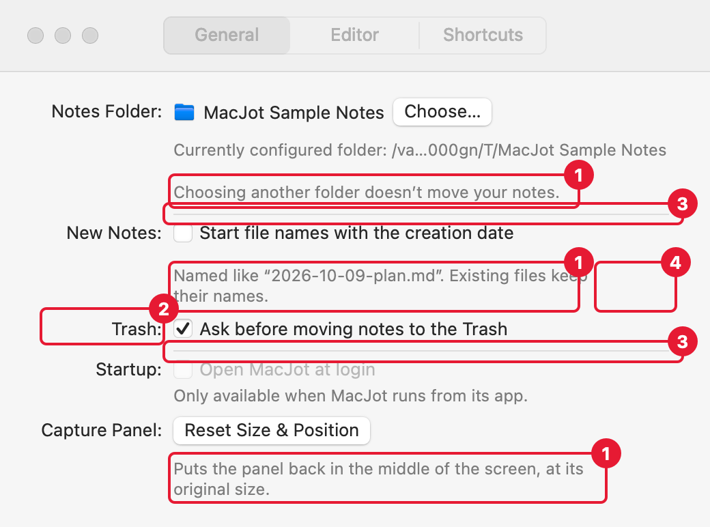
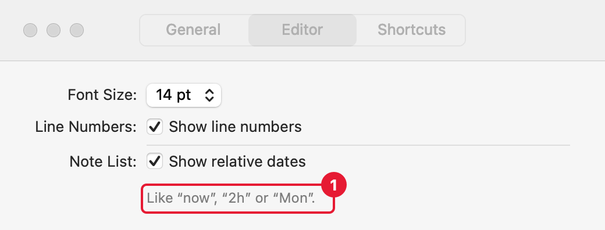
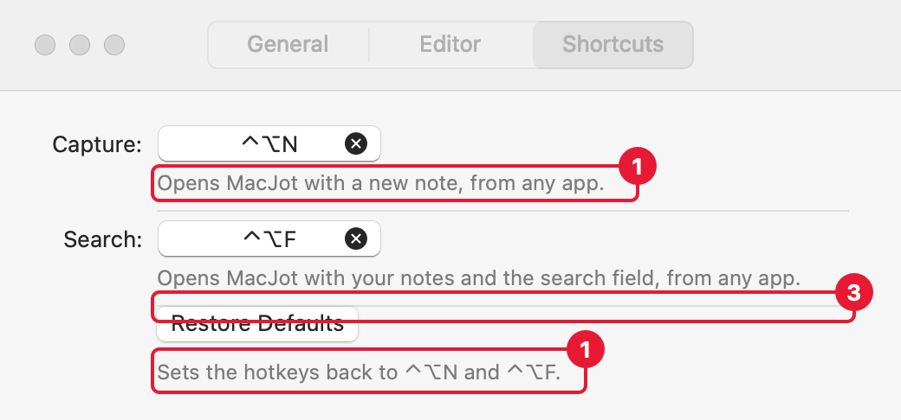
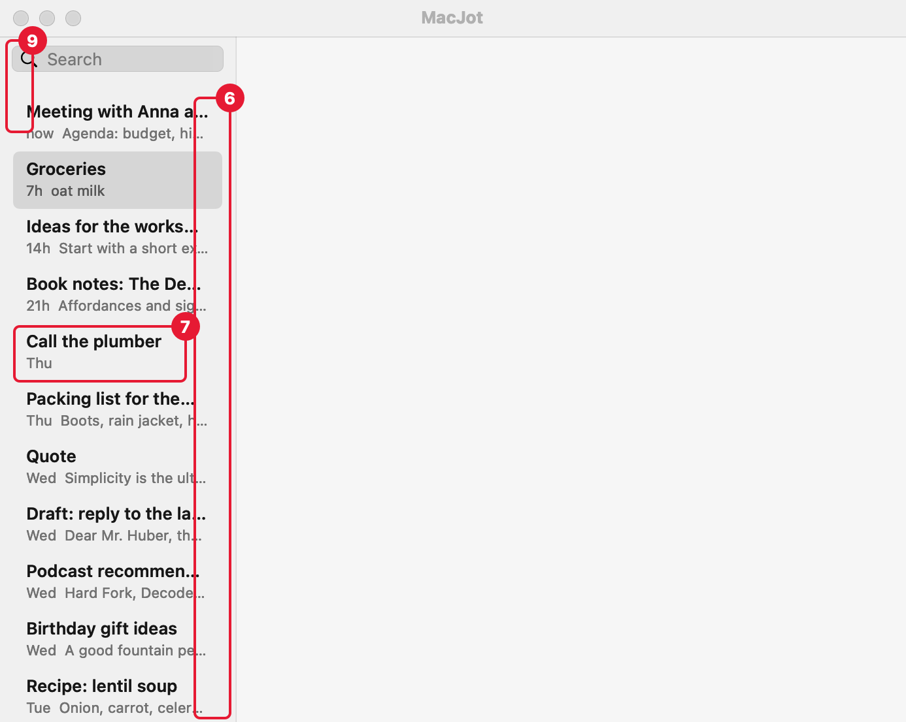
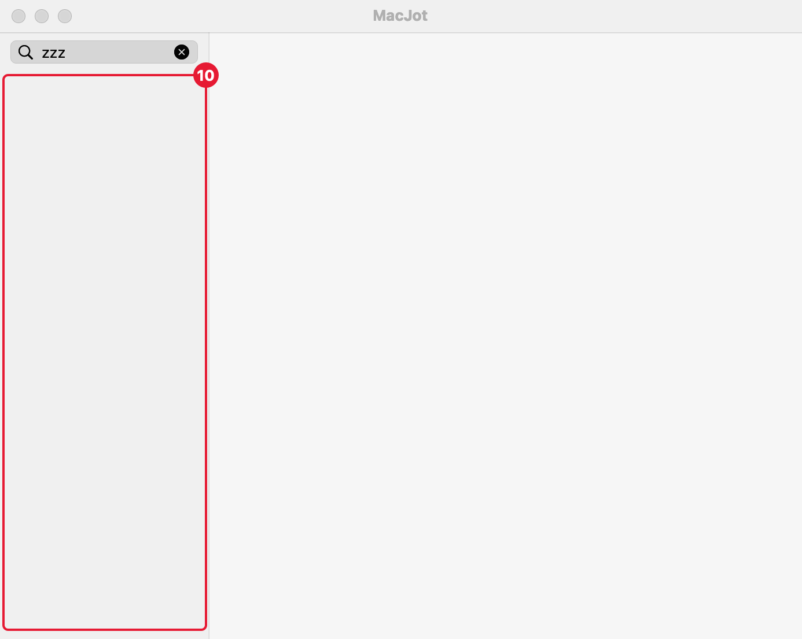

# HIG audit: Settings and the Note List (ticket 19)

Audited 2026-10-09 against the Human Interface Guidelines (pages: Settings, Layout, Sidebars, Lists and Tables, Split Views, Search Fields, Typography) and the sizes AppKit itself reports for its standard controls on macOS 27. Renders are offscreen, at 2×, light mode; dark mode has the same layout and no findings of its own (`settings-general-dark.png`, `notelist-dark.png`). Red marks carry the finding's number. To render again (e.g. before/after for tickets 20 to 22): `.scratch/hig-audit/render/render.sh <output dir>`; it uses sample Notes, never the real Notes Folder.

**What the HIG gives and what it doesn't.** For macOS, the HIG's Layout page has no spacing numbers at all; the guidance is principles (group related items with space, align elements). Concrete numbers here come from three places, named in each finding: the HIG's macOS text styles table, AppKit's own control sizes (measured), and MacJot's code. Comparisons with Safari and Mail Settings and Apple Notes' list are marked **to verify**: this session couldn't take screenshots (no Screen Recording permission), so those values are from Apple's apps as commonly laid out, not measured. Screenshots of Safari > Settings > General and a Notes window would settle them.

**Answered 2026-10-09:** all proposals followed (separators in finding 7: no). Fixes are tickets 20 to 22.

---

## Settings

### 1. The gap between a control and its explanation differs everywhere

- **Now:** the grey explanation sits 4 pt below its control under Startup and both hotkeys, 10 pt under Notes Folder (first line), Capture Panel and Restore Defaults, and 16 pt under New Notes, Notes Folder (second line) and Note List (Editor). The cause is a mix of the `blankLine` paddings (0, 6 or 12 pt) on top of the stack's 4 pt.
- **Reference:** HIG Layout: "Group related items to clearly express related information... using negative space." An explanation belongs to its control, so it should sit close to it, and the same way everywhere. Apple's Settings windows put the small grey text directly under its control (to verify).
- **Proposal:** one rule for all panes: explanation 4 pt below its control; a second explanation line (Notes Folder) 4 pt below the first. Drop the `blankLine` paddings.
- **Answer:** fix (2026-10-09) → ticket 20

### 2. Explanations sit closer to the next row than to their own control

- **Now:** rows are about 8 to 12 pt apart (the `.columns` form's default spacing), the same as or less than the control-to-explanation gap in finding 1. "Existing files keep their names." is 16 pt below its checkbox but only about 12 pt above "Trash:", so it reads as if it belonged to Trash. This is most of the "cramped" feeling: there's no visible step between "inside a setting" and "between settings".
- **Reference:** HIG Layout, grouping by negative space (as above). Apple's Settings windows separate settings noticeably more than a control from its explanation (to verify).
- **Proposal:** with finding 1's 4 pt inside a setting, put 16 pt between settings (rows), so the space between settings is clearly larger than the space inside one.
- **Answer:** fix (2026-10-09) → ticket 20

### 3. Dividers have little space around them

- **Now:** about 8 pt above and below each divider (between Notes Folder and New Notes, between Trash and Startup, above Restore Defaults), less than between plain rows in finding 2's proposal.
- **Reference:** HIG Layout: separator lines show which elements are related; a divider marks a bigger break than a row gap, so it needs at least as much space. Safari's and Mail's Settings use generous space around dividers (to verify).
- **Proposal:** 16 pt above and below each divider, i.e. a divider gets the row gap on both sides.
- **Answer:** fix (2026-10-09) → ticket 20

### 4. Explanations wrap at the control's width, not the column's

- **Now:** "Named like “2026-10-09-plan.md”. Existing files keep their names." and "Puts the panel back in the middle of the screen, at its original size." break after about 300 pt, the width of the checkbox or button above them, while the column (and the dividers) is 460 pt wide. This leaves ragged two-line texts that would fit on one line.
- **Reference:** HIG Layout, alignment: elements in a column share its edges. The Notes Folder path line above shows the intended width.
- **Proposal:** let explanations use the full column width (`.frame(maxWidth: .infinity, alignment: .leading)` on the stack), so both texts become one line.
- **Answer:** fix (2026-10-09) → ticket 20. **Withdrawn while implementing:** the misreading was mine. The column is 364 pt; the two texts need 377 and 375 pt, so they wrap anyway, and macOS's line breaking moves the second-to-last word down to avoid a single word on the last line. Nothing to fix.

### 5. Known deviation: Settings doesn't reopen on the last pane (no action)

The HIG's Settings page says "Restore the most recently viewed pane." Ticket 18 deliberately does the opposite (always General), decided 2026-10-09. Listed only so it isn't mistaken for an oversight later.

---

## Note List

### 6. The list starts at its minimum width, so almost every Title is cut off

- **Now:** the sidebar opens at 180 pt, its minimum (maximum 320 pt). At that width a Title shows about 20 characters and the preview 2 to 3 words; 10 of the 12 sample Titles are truncated. The width the user drags to isn't saved, so it's back to 180 pt after every launch.
- **Reference:** HIG Split Views: "Set reasonable defaults for minimum and maximum pane sizes." HIG Lists and Tables: "Keep item text succinct... minimize truncation." Apple Notes' list opens noticeably wider than its minimum and keeps the width you set (to verify).
- **Proposal:** open at 240 pt (the editor keeps about 450 pt in the default 693 pt panel) and remember the width the user sets (an autosave name on the split view).
- **Answer:** fix (2026-10-09) → ticket 21

### 7. Rows are tight: little space above, below and between the two lines

- **Now:** rows are 44 pt high with a 13 pt Title and an 11 pt date/preview line, 2 pt apart, so about 6 pt top and bottom. There are no separators, so the only gap between two Notes is those 6 + 6 pt.
- **Reference:** HIG Typography, macOS text styles: Headline 13 pt on a 16 pt line, Subheadline 11 pt on a 14 pt line, together 30 pt. AppKit's own sidebar rows are 24, 32 or 40 pt for one line. Apple Notes uses roomier two-line rows with thin separators between them (to verify).
- **Proposal:** 52 pt rows: 10 pt top and bottom, 3 pt between the lines. Optionally thin separators between rows like Notes (decide separately: *fix with separators* / *fix without*).
- **Answer:** fix, without separators (2026-10-09) → ticket 21

### 8. The Title is semibold; the HIG's Headline style is bold

- **Now:** `systemFont(ofSize: 13, weight: .semibold)`.
- **Reference:** HIG Typography, macOS: Headline is 13 pt **bold** (AppKit: `preferredFont(forTextStyle: .headline)` = SF bold, 13 pt). The date/preview line already matches Subheadline (11 pt).
- **Proposal:** use the Headline text style for the Title. A small visual change; it doesn't help crampedness, only consistency.
- **Answer:** fix (2026-10-09) → ticket 21

### 9. Left edges don't line up

- **Now:** the search field starts 9 pt from the sidebar's edge, the row highlight 10 pt, the row text 20 pt. The search field sits 6 pt below the title bar.
- **Reference:** HIG Layout: "Align elements to make them easier to scan." In Apple's sidebars, the search field and the row highlights share their edges (to verify).
- **Proposal:** give the search field the row highlight's edges (10 pt on both sides) and 10 pt below the title bar, so the field, the highlights and the gaps form one column.
- **Answer:** fix (2026-10-09) → ticket 21

### 10. No message when nothing matches, or when there are no Notes

- **Now:** a search with no matches, and an empty Notes Folder, both show an empty list: nothing says why.
- **Reference:** Apple's standard for this is a centred grey "No Results" (SwiftUI's `ContentUnavailableView.search`; Notes shows "No Results" in its list, to verify). HIG Search Fields: search should give immediate feedback while typing.
- **Proposal:** centred grey text in the list: "No Results" while searching (maybe with "for “zzz”"), "No Notes" in an empty folder.
- **Answer:** fix (2026-10-09) → ticket 22

### 11. Row height ignores the user's sidebar size setting (recommend skip)

- **Now:** the 44 pt rows and their fonts stay the same whatever the user picked under System Settings > Appearance > Sidebar icon size.
- **Reference:** HIG Sidebars, macOS: "A sidebar's row height, text, and glyph size depend on its overall size, which can be small, medium, or large." AppKit's sidebar rows are 24 / 32 / 40 pt for those sizes.
- **Proposal:** skip. That guidance is for one-line navigation rows with icons; the Note List's two-line rows are content, like Notes' and Mail's lists, which don't follow the setting either (to verify).
- **Answer:** skip (2026-10-09)

---

## Checked and fine

- Settings window: only the close button is active; the title names the pane; the toolbar isn't customisable and always shows the active pane (HIG Settings, macOS).
- Settings margins: 30 pt left and right, 20 pt top and bottom, right-aligned label column with the controls left-aligned next to it.
- Font sizes: explanations 12 pt (Callout), labels and controls 13 pt (Body), list detail 11 pt (Subheadline), as in the HIG's macOS text styles.
- Split view divider: the thin 1 pt style (HIG Split Views: "Prefer the thin divider style").
- Dark mode: same layout, system colours throughout, no contrast problems.

## Not covered

- The Startup row in the General render shows its "only available when MacJot runs from its app" state, because the renderer isn't an app bundle; in the real app it's just the checkbox. Its spacing follows findings 1 and 2.
- The segmented switcher renders its selected segment oddly offscreen (a known render artefact).
- Keyboard focus rings and the search field's focused look can only be checked in the running app.
